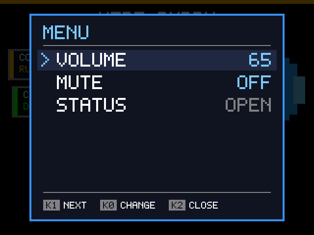
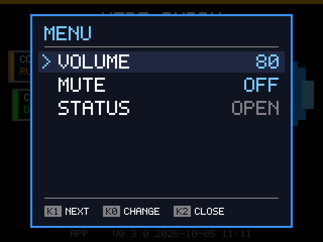
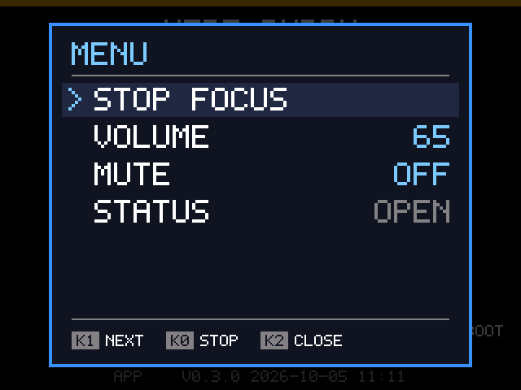
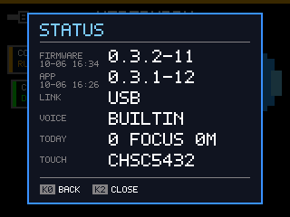
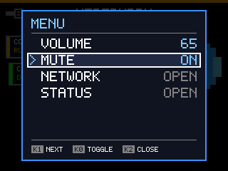
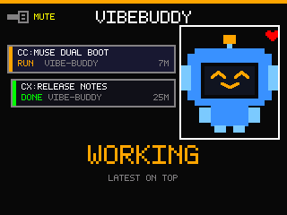

# Device menu

Status: built 2026-10-05. The screens below are rendered by the firmware itself on the Mac (`cargo run -p vibebuddy-firmware-core --example menu_preview -- <directory>`).

## Why

Every key gesture the box has is a separate thing to remember, and half of the six are hidden: K0, K1 and K2 each have a long press. Nothing on the screen says they exist, so they're found by reading the README or not at all. The box also can't show or change its own volume: that lives in the app.

The firmware of Meta's [Muse gadgets](https://github.com/facebookincubator/muse-gadget-sdk), which runs on boards much like this box, solves the same problem with two keys: one opens a menu and steps down it, the other acts on the selected row. Values cycle on each press, so the menu needs no long press, and hints on the screen say what each key does right now. This proposal takes that structure and keeps what VibeBuddy's keys are for.

## What stays one press away

The frequent actions keep their keys, unchanged:

| Gesture | Does | Change |
|---|---|---|
| K0 | Pomodoro start / pause / resume | none |
| K0 long | Give up the current phase | none (also in the menu) |
| K1 | Switch between On duty and Pomodoro | none |
| **K1 long** | ~~Leisure now~~ | **opens the menu** |
| K2 | Take me to the agent's window | none |
| K2 long | Mute toggle | none (also in the menu) |

Muse manages with two keys because many of its boards only have two. This box has three, and K2's jump back to the agent is the most used and most VibeBuddy thing it does, so K2 stays out of the menu's way. K1 long is the one to give up: Leisure starts on its own after a while on duty, and starting it on demand turned out to be of little use, so it isn't in the menu either.

## The menu

- **Opening**: K1 held for a second (the existing long-press threshold). It opens as soon as the long press fires, while K1 is still down; the release does nothing.
- **In the menu**: K1 moves to the next row (wrapping), K0 acts on the selected row, K2 closes. The keys keep a role close to their usual one: K1 is the mode-and-menu key, K0 the "do it" key, K2 the "get me out of here" key.
- **Closing**: K2, or 30 s without a key, as in Muse. The menu always opens on its first row.
- **Values cycle**: K0 on a value row steps to the next value and wraps. No long presses inside the menu.
- **Hints**: the bottom of the panel names what each key does in the current view.

### Rows

| Row | Shown | K0 does |
|---|---|---|
| STOP FOCUS / END BREAK | only while a phase is running, paused or waiting to start its break | gives up the phase, like K0 long, and closes the menu |
| VOLUME | always | steps 20 → 35 → 50 → 65 → 80 → 100 → 20 and plays the "All done!" line at the new level, as the app's preview does |
| MUTE | always | toggles mute, like K2 long |
| COMPUTERS | on a box with a key (ADR-0012); shows how many computers are paired | opens the COMPUTERS view below |
| NETWORK | always | opens the network view; K0 there goes back |
| STATUS | always | opens the status view; K0 there goes back |

 

Volume steps are coarse on purpose: six presses cover the range, and the app's slider is still there for a value in between. A level set from the app that isn't a step (say 70) shows as 70 and moves to the next step up.

### Status

What the box knows about itself, with nothing to change: the firmware and app builds (version over build time, see [`pet.md`](pet.md#build-identifiers)), how it is linked to its computer (LINK, as in the network view), the voice pack, today's focus tally and whether the box has a touchscreen (TOUCH: the chip's name, or NONE). Volume and mute aren't repeated here: the menu's own rows already show them. It's where "is it the box or the computer?" gets answered without opening the app.

### Computers

Who trusts the box. K1 moves, K0 opens, K2 closes; BACK returns to the menu.

| Row | Shown | K0 does |
|---|---|---|
| FORGET ALL | while computers are paired; shows how many | asks FORGET ALL?; K0 there forgets every paired computer, K1 goes back. Each computer pairs again the next time it's plugged in |
| NEW ID | always | asks NEW IDENTITY? (what goes and what stays), then SURE?; K0 at both makes the box a new identity, K1 at either goes back (#122) |
| BACK | always | back to the menu |

A new identity is for a box changing hands or a key that may have leaked (flash isn't encrypted, ADR-0014). The box draws a new key from its hardware random number generator and forgets the paired computers, its Wi-Fi network and its Relay (back to the default). Its Character, voice, volume and tally are kept elsewhere and stay. It prints `NEW IDENTITY <key>` and restarts. With a new key it is a new box to everyone: each computer pairs again over USB, and until then its local-network and Relay attempts fail on the key; the daemon takes the new key only from `BOX KEY` on the cable, never from the network. The old id's place on the Relay is simply never used again.

### Network

How the box reaches its computer, as rows a glance can read; anything dimmed isn't working:

| Row | Shows |
|---|---|
| LINK | `USB`, `LAN` or `RELAY`, the way the computer is linked now (USB wins, then the local network, then the Relay); `NO LINK` dimmed without one |
| WIFI | the network's name, dimmed until the box has joined it; `OFF` with none set |
| RELAY | `PROD` or `STAGING` for the Relay the box uses (docs/relay-protocol.md, "Which Relay"), the host for any other; `DOWN` after it, dimmed, while not connected; `OFF` without Wi-Fi |

### The link icon

Every screen shows how the box is linked as a small icon in its top left: a plug for USB, Wi-Fi waves for the local network, a cloud for the Relay. While that link goes through the staging Relay, `STG` follows the cloud in orange, so a development build is never mistaken for a release; over USB or the local network the Relay isn't in the way, so no `STG` shows (the NETWORK view still names the Relay). No icon shows without a link: the screen already says NO LINK. MUTE, when on, comes after them.

## Touch

Some boxes have a touchscreen (ADR-0017). The firmware looks for one at boot and, on a box without, nothing here changes. On a box with one, a tap (down and up quickly, in about the same place) does what the keys do:

- **A row** is selected and acted on at once, as K1 to the row and then K0 would. VOLUME steps, MUTE toggles, COMPUTERS opens; FORGET ALL and NEW ID still ask first.
- **A key hint** along the bottom is that key: tap CLOSE to close, BACK to go back.
- **A task card** on duty takes you to that card's agent: the box sends the card's id in a `focus` event and the daemon opens it, the way K2 opens the most pressing one ([`protocol.md`](protocol.md)).
- **The buddy** on duty, outside the menu, is petted: it hops with a heart for a moment, and nothing else changes.

The tapped row, hint, card or buddy is outlined for a moment, so a tap that landed is seen to. A tap in Leisure only calls the buddy back, like any key, and wakes a screen dimmed for the night. The menu still opens on K1 held, and the Pomodoro screen has nothing to tap: a box on a desk gets brushed, and the timer stays on K0. Every tap prints `TAP <x> <y>` as a diagnostic line.

 

## Behavior around the menu

- **Agent events don't wait for the menu.** An event that needs the user (input required, failed) closes the menu so the screen can show it; its line is announced as usual. Other events (working, done) update the screen underneath and show once the menu closes. A Pomodoro phase ending closes the menu too, since its alarm needs K0.
- **Leisure** is left for On duty the moment the menu opens, like any key press today, and doesn't start while the menu is open.
- **Volume and mute stay where they are.** The menu changes the same values as the app and K2 long. A volume change from the menu prints the `VOLUME <n>` line `device.volume` already uses, so the daemon's status, and the app's slider, follow; mute keeps its `MUTE ON` / `OFF` lines and stays device-only, as [`app.md`](app.md) says.
- **Nothing moves to the box that belongs to the Mac.** Connecting agents, the voice library, firmware updates, launch at login and notifications all stay in the app: they need the Mac's files, network or system settings. The box holds one voice pack at a time, so there's nothing to choose between on it. The menu is about making the box's own controls visible, not about replacing the app.

## Constraints from the hardware

- **Backlight is on or off**: it is bit 7 of the XL9555 expander, not a PWM pin, so there is no brightness row.
- **The font is 5×7 ASCII** with gaps: no `/` or `+` (they draw as `\` and a stray glyph), so menu text avoids them. Labels are uppercase, as everywhere else on the screen.
- **Key positions**: the hints name the keys rather than pointing at them, since the case's key layout isn't drawn anywhere on screen today.

## Where it lives

All of it is firmware logic that doesn't touch hardware, in `firmware-rs/core` beside the Pomodoro and Leisure state machines: `menu.rs` decides what a key means in the menu (rows, selection, idle timeout), `firmware.rs` carries out the action and builds what the panel says, and `display.rs` draws a `Panel` over the screen. Volume, mute and giving up a phase each run through one function that the old gestures and the protocol share; the device layer needs nothing new. The firmware prints `MENU OPEN` and `MENU CLOSED` as diagnostic lines.

## Docs that change with it

`CONTEXT.md` (key terms), `README.md` and `README.zh-CN.md` (the Pomodoro paragraph), [`leisure.md`](leisure.md) (its "Long press K1" section), [`protocol.md`](protocol.md) (keys not reported, the `VOLUME` line now also sent unprompted), [`firmware-bringup.md`](firmware-bringup.md) (key checklist) and [`app.md`](app.md) (volume can change from the box). The key mapping change gets an ADR.

## Decisions

- The menu is built even though it has few rows: it gives the box's own controls a place to grow.
- STATUS stays about the box; agent detail stays on the cards.
- The panel covers the whole screen, buddy included, rather than a narrower panel beside it.
