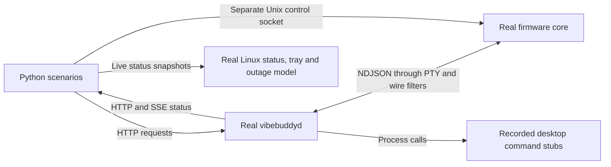

# Linux host tests with a simulated box

These tests exercise the computer-side code without a box or a desktop: the real daemon, the firmware core running as
the simulator (`firmware-rs/core/examples/simulator.rs`), and the Linux app's status decoder, tray model and
daemon-failure policy. They also cover the Linux parity changes in `platform-parity.md`: the daemon-failure
notification and K2 on Sway and X11.

## Run

On Linux, with Python 3.10+, the workspace Rust toolchain, `pkg-config`, `libudev` development files and OpenSSL
development files (used by the simulator's Relay client):

```sh
bash tools/test-linux-host.sh
```

The first build needs Cargo registry access. The tests themselves use only local processes, Unix sockets, PTYs and
loopback HTTP. No Python packages, logged-in desktop, root access, serial-group membership or attached box are needed.
An execution sandbox must permit those local sockets and PTYs.

Use unittest's name filter for a subset:

```sh
bash tools/test-linux-host.sh -k k2
```

The runner builds the daemon, the headless Linux app probes (`host_status_probe`, `daemon_outage_probe`) and the
simulator in `target/`. Ordinary `python3 -m unittest discover -s tools -p 'test_*.py'` skips this suite; the runner
sets `VIBEBUDDY_HOST_TESTS=1`. CI runs it on Ubuntu and uploads `target/host-tests` as a diagnostic artifact on
failure, retained for seven days.

## Harness boundaries



`tools/host_test_support.py` owns the processes and PTY. Each scenario uses a new temporary config/state tree,
pairing identity and available loopback port. `VIBEBUDDY_SERIAL_PORT` points only to its PTY symlink. The daemon's
environment omits `HOME`, agent hooks and desktop bus variables; explicit XDG directories keep its files isolated.
Update checks and Relay use are disabled, with loopback-only fallback URLs, and CI repository polling is empty.

`hyprctl`, `swaymsg`, `wmctrl`, `xdg-open`, `notify-send`, `systemctl` and `gh` resolve to per-test stubs. Their argument
lists are recorded; responses, exit codes, stderr and a `sleep` before answering can be configured with
`command_reply`. Without `args` a reply answers every call; with `command_reply(name, args=[...], ...)` it answers calls
that start with those arguments, so a window listing and the focus call can differ. The window listings are synthetic
(`tools/fixtures/linux-windows/README.md`).

K2 reads the window system from the environment of the processes it focuses, so the agent's ancestors are real. The
scenarios and listings name placeholder pids (4242, 4000, 4343, 5151); `use_session` starts a process for each with
exactly the session environment a scenario wants (a live Hyprland by default), and the harness puts their real pids in
the hook's reports and the stubs' replies. Hyprland's and Sway's sockets are real listening Unix sockets
(`listening_socket`), since the daemon believes only a socket that accepts a connection. The daemon in the harness is
started by hand, so it reports `supervisor: "other"`; the outage scenarios set `VIBEBUDDY_SUPERVISOR=systemd`, as an
installed daemon would report.

The PTY has no USB VID/PID metadata. The explicit-port path therefore assumes bridge pacing and reports
`device.bridge=true`. USB discovery, write timing, DTR reset, udev permissions and actual re-enumeration still need a
box. Replug tests replace the PTY behind a stable symlink. The harness clears `TIOCEXCL` after stopping its daemon
because it retains a slave handle between processes.

## Signal and response coverage

Firmware-generated signals go through real parsing, aggregation, serial transport and HTTP/SSE publication. Cases
marked synthetic deliberately inject or replace output to exercise device-layer callbacks or broken peers.

| Stimulus / signal | Computer-side response checked |
|---|---|
| Boot build/version, voice, volume, `LINK NOISE`, `BOX KEY`, `PAIRED`, pair list | Firmware recognized; identity and settings reach status; automatic pairing completes. Box firmware names no board. |
| Synthetic `BOARD goouuu-s3-spi` | Host records the unsupported board, so no released firmware is offered. |
| Identify; volume set/preview; invalid volume; unsolicited `VOLUME`; `VOLUME ERROR` | Correct command/reply, range validation and device-owned volume in status. |
| Working, needs input, failed, done events | HTTP events reach the firmware's display and announcement paths. |
| K2 short press on release | Source focus command; needs-input priority; completed source retained; destination survives daemon restart. |
| Nearest ancestor window; Lua dispatch rejected; desktop command fails | Correct PID choice, legacy Hyprland fallback and recovery on the next press. |
| K2 on Sway: nearest ancestor's container focused with `swaymsg`; needs-input priority; completed source survives a restart; refused focus, failing or slow `swaymsg`, missing window, malformed tree; a stale `SWAYSOCK` falls back to Hyprland | `SwayFocusTests`. `swaymsg -t get_tree` and `[con_id=N] focus` are answered by a synthetic tree and reply. A refused focus is logged with its reply and the next press recovers; failures and timeouts are logged, and nothing else is focused. |
| K2 on X11: nearest ancestor raised with `wmctrl -i -a`; missing, malformed or invalid listing rows; refused raise; failing or slow `wmctrl`; an Xwayland session stays on Hyprland | `X11FocusTests`. `wmctrl -l -p` is answered by a synthetic listing. Invalid rows are skipped, and errors are logged with their stderr. Missing executables, the selection rules and parsing a process's or systemd's environment are covered by unit tests in `daemon/src/window_focus.rs`. |
| Window-system evidence: the agent's processes run Sway while systemd's user manager and the daemon still hold an ended Hyprland session's variables; only a stale Hyprland signature, with agent processes that say nothing graphical; agent processes that can't say, with Sway in the user manager; GNOME on Wayland with Xwayland's `DISPLAY` while the user manager holds an earlier X11 login | The agent's session wins and nothing else is asked; a stale signature or a socket nobody listens on picks no backend, runs no helper and logs that the session runs no supported window system; systemd's user manager is the fallback, taken whole. |
| K0/K1 taps, K2 hold, K1 hold and menu K2 | Pomodoro/mode diagnostics reach status; mute/menu actions stay local and do not open a source. |
| Firmware clock advanced across a focus period | Focus completion diagnostic without waiting 25 minutes. |
| Disconnect, new PTY, device reset | Offline/reconnect status; settings and pairing key restored from the same simulated flash. |
| Second computer paired then unpaired; self-unpair request | Pair list changes; host refuses to remove its own pairing. |
| Wi-Fi set/scan/forget commands; synthetic scan/failure/join/address/disconnect lines | Commands reach firmware; host deduplicates/sorts scan results and clears failure/address state appropriately. No radio is simulated. |
| Legacy voice pack and current Character pack, sent as `xfer.*` chunks (the firmware core reports `TRANSFER 1`, ADR-0016) | Completed operation, saved Character selection and device storage, kept across a box restart. |
| A pack larger than the voices partition; an `xfer.error` partway; a second write while one runs | The box's `too_big` at `xfer.begin` fails the write before any chunk; a refusal partway fails it with the box's code and leaves the saved selection alone; the second write gets 409; a retry succeeds. |
| Acknowledgements dropped, stale or repeated | At most 16 chunks go unacknowledged; after 20 s without an answer the daemon asks again with `xfer.begin` and the box answers with its offset, so nothing is sent twice; the furthest acknowledgement counts. |
| An unplug partway that restarts the box | **Known gap, pinned as it is:** the restarted box answers the chunks still in flight with `sequence`, and the daemon fails the write instead of starting over. Until those stop, a retry fails the same way. Reported on #153. |
| HTTP/SSE device updates; snapshots consumed by Linux app probe | Live status changes; real app decoder and online/offline/daemon-down tray model. |
| Split/coalesced CRLF lines, malformed JSON/version, oversized diagnostic | Recovery to valid status without launching a source. |
| Screenshot from the simulator; synthetic incomplete frame and malformed run | A 320×240 PNG; incomplete and malformed pixels become HTTP errors. |
| Factory log line followed by several heartbeat intervals, then ROM reset/build | No hello or heartbeat is written to foreign firmware; normal traffic resumes after our build appears. |
| Daemon stopped (status stream retries every 2 s), with the unit `inactive`, `failed`, unreadable, slow or never read, and the app's notify toggle on, off or never read | `DaemonOutageTests`. `daemon_outage_probe` runs the app's real status stream through the outage policy and its `systemctl`/`notify-send` adapters. One `notify-send` per outage after a 4 s grace (shortened for the probe; the 30 s boundary is unit-tested with explicit instants); none for a brief restart, a stopped unit or a disabled toggle; rearmed after recovery. |
| Inactive service followed by failed startup with no status recovery; restart requested while HTTP is down | The outage policy rechecks the stopped service and notifies when it later fails. The same restart adapter used by Advanced and the tray calls systemd without HTTP and reports a refused restart. |
| A daemon that doesn't run as the systemd service: its status, its restart endpoint, an outage with the unit `inactive`, a restart from the app | Status says `supervisor: "other"`; the endpoint refuses with 409 and the daemon keeps running; the outage notifies without asking systemd and says to start the daemon again by hand; Restart calls no `systemctl` and says why. |

`tools/fixtures/device/wifi.json` contains synthetic device-layer reports, using test-only network names and a
documentation-range IP address. Other scenarios generate actions directly or run the actual firmware core.

## Diagnostics and extension

Artifacts remain under `target/host-tests/<scenario>-<unique suffix>/`: daemon/simulator logs, `wire.jsonl` with
host/device/delivered bytes, desktop command invocations, and the isolated config/state files. Override the parent
with `VIBEBUDDY_TEST_ARTIFACTS`. Process cleanup runs even if setup fails. Keep the failure directory when reporting
a regression; it contains synthetic test data and test identities.

For a new case, create a `HostHarness`, register `close` before `start`, then use:

- `control("buttons", k2=True)`, `control("advance", ms=80)` and `control("buttons")` for levels, or `press("K2")`.
- `control("reboot")` to keep simulated flash while reinitializing firmware.
- `emit(...)` for raw broken or device-layer reports; `filter(drop=..., replace=..., fragment=...)` for wire faults.
- `request`, `wait_device`, `wait_operation`, `wait_line` and `commands` for observable results and bounded waits.

The clock control advances **firmware** time only. Host receipt deadlines, reconnect delays and notification grace
periods still use real time. Rust unit tests cover the host's timing rules; advancing the firmware clock does not
validate the daemon-failure timer. The desktop client's local TCP regression tests separately check response-header
stalls, an open stream that stops sending bytes, and SSE keepalives preserving a healthy stream beyond its inactivity
timeout. Production limits are 10 s for Linux response headers and 45 s for stream inactivity (45 s on the Mac too);
the 30 s outage grace starts once the Linux client reports the daemon down.

For manual serial-tool development:

```sh
python3 tools/simulate-device.py --control /tmp/vb-control.sock
```

It prints its PTY path. A separate process can send one NDJSON command per Unix-socket connection; the reply is
`{"ok":true,"now_ms":...}` after the command has been applied and firmware polled. The socket is test-only and is
never part of the device protocol or daemon API. `--tcp` and `--relay` remain available for network development.

## Acceptance still required

The suite does not launch the iced window, exercise the real tray host or desktop notification server, or focus an
actual window. The Sway and X11 focus backends are checked against synthetic window listings, not a real compositor or
X server, and not with the environment a real systemd user service starts with. The daemon-failure notification is
tested headless through the app's stream and the stubs, not on a real notification server or systemd unit. The Mac
side of the failure notification (the retained toggle and the 45 s stream timeout) is not compiled or run here. It
does not establish Claude or Codex Linux app session handling. Sound, USB discovery and timing, LAN/Relay handover and
flashing are separate acceptance tasks.

## Validation

On the branch that brought this suite in, after merging upstream `main` at `569f892`: the full runner passed 61
scenarios (29 device and host, 13 daemon outage, 12 Sway, 7 X11). The pack-write scenarios follow the `xfer.*` protocol
that upstream brought in; one pins the known gap above. Breaking each rule the review fixes added (every socket counted
as live, the agent's own processes ignored, the outage policy blind to the supervisor) failed the scenarios meant to
catch it. `cargo test --workspace` passed, as did Clippy, with the warnings `574b700` already had and one in upstream's
`daemon/src/resident.rs`. The localization check passed. No box, graphical desktop or Mac was used.
