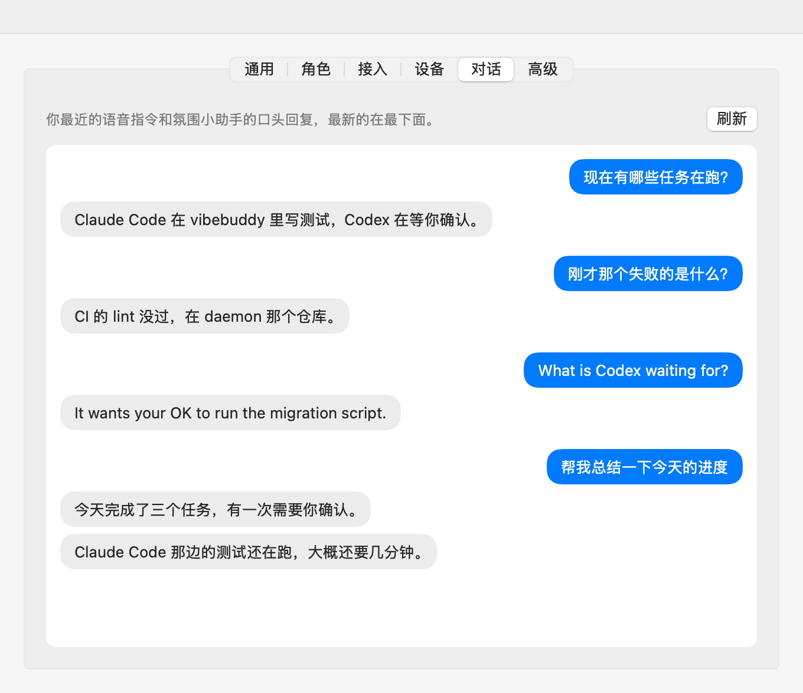

# Resident session

The resident session is the one long-running Agent session every voice command goes to ([ADR-0017](adr/0017-voice-commands-go-to-a-resident-session-that-speaks-as-the-buddy.md); see "Voice commands" in [`CONTEXT.md`](../CONTEXT.md)). A voice command reaches it spoken to a box linked over USB or the local network (below), or typed with `vibebuddy say`.

It runs on one of two brains: the user's own Codex (a Codex thread, most of this page), or the user's own Claude Code with their own Anthropic API key (a Claude Code session, "On Claude Code" below). Which one is a setting: `codex`, `claude`, or `auto`, the default: Codex when it is ready, else Claude Code when a key is set. Each brain keeps its own session for good; switching brains switches which session voice commands go to and which history the Conversation tab shows.

It is experimental and off by default. Start `vibebuddyd` with `VIBEBUDDY_RESIDENT_SESSION=1` to turn it on. Voice needs one of the brains on the computer the daemon runs on: the Codex CLI installed and signed in (`codex login`), or Claude Code installed with the user's Anthropic API key entered in the Conversation tab. Without either the box isn't offered voice, and the Conversation tab says what's missing. While it is on, both Apps' settings windows have a Conversation tab that shows it (below); nothing else of it is in the App UI, on the Mac or on Linux.

## Using it

```sh
vibebuddy say "What are my agents doing?"   # prints the spoken reply(ies); the time taken goes to stderr
vibebuddy resident [n]                      # prints the thread id and the last n (default 5) commands with their replies
```

The thread lives in a Codex home of the daemon's own (below), so the Codex App can't open it; `vibebuddy resident`, or the Apps' Conversation tab, is how to look back at it.

### The Conversation tab

Both Apps ask `GET /v1/resident` each time the daemon comes up (only its environment at start decides) and show a Conversation tab, between Device and Advanced, only while it says `enabled`. The tab reads the last 20 exchanges with `GET /v1/resident/history?limit=20` each time it is shown and on Refresh, and lists them oldest first, newest at the bottom: each voice command on the right, the buddy's spoken replies under it on the left. With none yet, it says how to talk to the buddy (hold K0); when the daemon can't be reached it points to Advanced → Restart daemon, and when the resident session can't be read (Codex missing or not logged in) it shows the daemon's reason. The last answer from `GET /v1/resident` is kept while the daemon is down, so an open tab says the daemon isn't running rather than vanishing.

While the tab is shown it updates by itself: it asks `GET /v1/resident` every 2 seconds and reads the history again only when `revision` moved (or voice just became ready), so a new exchange shows up on its own and the list stays scrolled to the newest. It stops asking when another tab is picked or the window is closed. A daemon older than `revision` gets its history read every 5 seconds instead. When the answer says voice isn't ready, the tab says what's missing in place of the conversation: Codex not installed, with a link to OpenAI's [Codex CLI page](https://learn.chatgpt.com/docs/codex/cli); or not signed in, with `codex login` to run in a terminal (under Automatic it adds that Claude Code can answer instead, with the user's own key); Claude Code not installed, with a link to Anthropic's [setup page](https://code.claude.com/docs/en/setup); or no Anthropic API key yet. It notices the fix within half a minute.

Above the conversation, while the daemon says `brain_setting`, the tab has the brain setting, "Answered by": Automatic, Codex or Claude Code (`PUT /v1/resident/brain`). Unless it is Codex, a secure field takes the user's Anthropic API key, with Save, and a link to the [Claude Console](https://platform.claude.com/) to make one; once the daemon has a key the field gives way to "Anthropic API key saved" and Remove. The key is never shown again: the daemon only says whether it has one. A line under it says the key is billed to the user's Anthropic account, that a Claude subscription can't be used, and that what they say and their Agents' task titles go to Anthropic.



`vibebuddy` is a second binary of the daemon package (`daemon/src/bin/vibebuddy.rs`). Like every client, it only talks to the daemon's HTTP API, at `VIBEBUDDY_BIND` (default `127.0.0.1:7331`):

| Endpoint | Does |
| --- | --- |
| `POST /v1/resident/say` `{"text"}` | Runs one turn; answers `{"thread_id","replies":[...],"elapsed_ms"}`. 404 when off, 503 when the brain is missing, not logged in or has no key, 504 after two minutes. |
| `GET /v1/resident` | `{"enabled","thread_id","revision","ready","problem","brain","brain_setting","anthropic_key_set"}`. `thread_id` is the session of the brain voice commands go to now (a Codex thread id or a Claude Code session id). `revision` goes up when a voice command's turn ends (answered or not, from the box or `say`), when the thread changes, and when the brain answering changes; it is kept in memory and starts at 0 with the daemon. `ready` is on and the brain the setting picks ready (Readiness below); `problem` is then `null`, else `codex_missing`, `codex_logged_out`, `claude_missing` or `anthropic_key_missing` (`null` while off). `brain` is `codex` or `claude` while ready, else `null`; `brain_setting` is `auto`, `codex` or `claude`; `anthropic_key_set` says whether a key is stored, never the key. Never starts the app-server or Claude Code. |
| `GET /v1/resident/history?limit=n` | `{"thread_id","exchanges":[{"said","replies":[...]}]}`, oldest first (default 5, at most 50): on Codex read from the thread with `thread/turns/list`, starting the app-server if it isn't running; on Claude Code read from the session's transcript. The daemon keeps no record of its own. |
| `PUT /v1/resident/brain` `{"brain"}` | Sets the brain: `auto`, `codex` or `claude`; answers as `GET /v1/resident`. |
| `PUT /v1/resident/anthropic-key` `{"api_key"}`, `DELETE` | Stores or removes the user's Anthropic API key for Claude Code; answers as `GET /v1/resident`, without the key. 400 for an empty key. A running Claude Code process is stopped, so the next command starts one with the new key. |

The brain setting and the key are kept in `resident-settings.json` in the config directory (`{"brain","anthropic_api_key"}`), written with mode 0600 and only through these two endpoints, never `PUT /v1/config`: that replaces the whole config, and an App that doesn't know the fields would wipe them (the same reason `speech.json` is a file of its own). Both work while the session is off.

## Readiness

Readiness is worked out under the brain setting from two checks, neither of which starts anything:

- **Claude Code**: `claude` found (`VIBEBUDDY_CLAUDE`, PATH, `~/.local/bin`, `~/.claude/local`, `/opt/homebrew/bin`, `/usr/local/bin`) and a key stored. Free, so it is made every time. `claude_missing` comes first, then `anthropic_key_missing`. Whether the key works is only known at the first turn: a rejected key fails that turn with Claude Code's message.
- **Codex**, below; skipped while the setting is `claude`.

Under `codex` or `claude` it is that brain's readiness. Under `auto` it is Codex when Codex is ready, else Claude Code when that is ready; when neither is, the problem is Claude Code's if a key is stored (the user means Claude Code) and Codex's otherwise, and nothing is said until Codex has been checked once. Changing the setting or the key checks again at once.

Voice on Codex needs the user's Codex, so the daemon keeps a readiness check that never starts the app-server or a turn: it looks `codex` up as a start does (`VIBEBUDDY_CODEX`, PATH, the usual install places) and runs `codex -c cli_auth_credentials_store="file" login status` in the resident Codex home (with `auth.json` linked as for a start), which reads the same login `account/read` would and exits 0 only when signed in. The answer stands for 30 seconds: `GET /v1/resident` checks again once it is older, and so does a timer in the daemon every 30 seconds while the session is on. Every start of the app-server is a check too: one that ends in "codex not found" or "not logged in" marks the session not ready, and one that gets through marks it ready.

The box is offered voice (`voice.available`, below) only while the session is on and ready and a recognizer is configured. When readiness flips, the daemon tells a box that has reported its build `"on":true` or `"on":false` right away (not over the Relay or the UART bridge, where voice is never offered), so a long K0 goes back to giving up the Pomodoro phase while the brain isn't ready (Codex missing or signed out, Claude Code missing or without a key).

## How it works on Codex

`daemon/src/app_server.rs` is a newline-delimited JSON-RPC client for `codex app-server` on stdio; `daemon/src/resident.rs` is the session on top of it, and picks the brain.

- **Its own Codex home.** The app-server runs with `CODEX_HOME` set to `resident-codex/` in the daemon's state directory (mode 0700), never the user's. The ChatGPT App's own app-server takes the writer lock (`thread-writer-locks/<id>.lock`) of every thread in `~/.codex` it lists whenever the lock is free, and keeps it, even for threads nobody opened; a resident thread there could not be resumed while the App runs. Nothing lists this home but the daemon. The home holds no `config.toml`: everything is a `-c` override (below).
- **The user's login, shared.** The user's Codex home is `$CODEX_HOME` if the daemon has it, else `~/.codex`. On every start `resident-codex/auth.json` is made a symlink to its `auth.json` (whatever else is there, a copy or a link elsewhere, is replaced), so there is one login and one set of tokens. Checked in the codex-cli 0.162.0 source (`codex-rs/login/src/auth/storage.rs`, `manager.rs`): the file store reads `auth.json` with a plain open, a refresh first reloads it and keeps a token the other side already refreshed, and a save truncates and rewrites it in place, so all of it goes through the link and the link survives; a rename on the user's side doesn't matter, since the link is by path. `-c cli_auth_credentials_store="file"` pins that store: the keychain store keys its entry by the Codex home's path, so it would never find the user's login, and its save deletes `auth.json`. A login kept in the keychain therefore can't be shared: the session reports "not logged in" and the log says why. Two Codex processes refreshing at the same moment can still race, as the user's CLI and the ChatGPT App already can on the same file. Credentials are never logged.
- **Starting.** On the first voice command, and on the next one after the app-server dies, the daemon runs the `codex` it finds (`VIBEBUDDY_CODEX`, else PATH, else `~/.local/bin`, `/opt/homebrew/bin`, `/usr/local/bin`, since launchd's PATH is bare). It sends `initialize` (`experimentalApi: true`) and `initialized`, then `account/read`: with no account it stops with "not logged in". It never starts a login.
- **One thread for good.** `thread/start` once, with `cwd` set to `resident/` in the daemon's state directory, `sandbox: "read-only"`, `approvalPolicy: "on-request"`, the developer instructions and the dynamic tools. The thread id is kept in `resident.json` beside it, and every later start sends `thread/resume` with the same settings (the tools survive a resume; the instructions are sent again). Only a thread that no longer exists (`no rollout found`) is replaced by a new one, saved, with both ids in the log. That is also what happens once to a thread saved before the session had its own home: it is in `~/.codex`, so the first start in `resident-codex/` begins a new thread; the old one's rollout stays where it is. Should another Codex process ever be the thread's writer, the resume fails with `already has an active writer`, the voice command fails as `unavailable`, and the next one tries again; the thread is never replaced for that, so there stays one resident session.
- **Only our tools.** In its own home none of the user's Codex config loads: not their `config.toml` (model, MCP servers, profiles), `AGENTS.md`, hooks, plugins or skills. Codex's own defaults still give a thread tools, so every start passes `-c features.<name>=false` for plugins, apps (connectors), the shell and exec tools, sub-agents, goals, memories, image generation and viewing, the browser and computer use, sleep, tool suggestions, skill search and shell snapshots; all but `memories` are on by default in an empty home (`codex features list`). Shell snapshots matter beyond tools: at every start Codex runs the user's login shell and saves its whole environment, API keys included, into the Codex home. Skills go too: `skills.include_instructions=false` drops the skill list, which otherwise names the user's own skills (`~/.agents/skills`, read whatever the Codex home), and `skills.bundled.enabled=false` stops Codex installing its bundled ones (`imagegen` and the like) into the home. System and managed config (`/etc/codex`, MDM) still load and may add MCP servers, and an override can't empty `mcp_servers` (it merges), so the daemon first asks `codex mcp list --json`, under the same overrides, which servers would be on, and adds `-c mcp_servers.<name>.enabled=false` for each (on this Mac: none). Overrides are `-c` rather than `--disable`, which refuses a feature name another Codex version doesn't know. The model and reasoning effort are set too (see Latency below), and Codex's built-in web search is on, `web_search="live"` (below). The thread's tool list is `speak`, `list_activities`, `search_memories`, the web search and what Codex always adds and has no switch for: `apply_patch` (refused by the read-only sandbox, its approval declined), a clock, and the MCP resource readers (no server is on to read from). The model calls all of these through Codex's code mode, an `exec` tool that runs JavaScript: switching the host off (`features.code_mode_host`) leaves no tool call working, so it stays on. That JavaScript reaches only the thread's tools: checked on 2026-10-14, it has no `fetch`, `require` or `process`, and `import` is refused, so no file, network or process access.
- **Memories, read-only.** The session reads the user's Codex memories (`<user Codex home>/memories/`) through the daemon, and Codex in its home never touches them. Codex's own memory feature (`features.memories`) can't do that safely: it gates the read path (injecting `memory_summary.md`) and, at every thread start whatever `generate_memories` says, the memory pipeline, whose consolidation phase rewrites `raw_memories.md` and prunes `rollout_summaries/` from the state database of the Codex home it runs in; in the resident home that database is empty, so on a linked folder it would empty the user's memories, and on a copy it would still run a consolidation agent each time. Its dedicated memory tools also include one that writes a note into the folder. So the feature stays off (and `memories.generate_memories=false`, should it come on), and the daemon does what the read path does: at every start or resume it puts `memory_summary.md`, cut at Codex's own cap of 10,000 bytes, into the developer instructions, and the `search_memories({query})` tool returns the lines of `MEMORY.md`, `raw_memories.md` and `rollout_summaries/` containing any of the query's words, each with the line before and after (at most 8,000 bytes). Both only read. Checked on 2026-10-13: a question answered from the summary, and one whose answer is only in `MEMORY.md`, answered after a `search_memories` call; the memories folder unchanged.
- **Tools.** `speak({text})` is the spoken reply: the daemon hands it on the moment it is called (`Resident::say_streaming`), to the box as `voice.reply`, or collected for `POST /v1/resident/say`. `list_activities({})` returns, as JSON, `{"activities","recently_ended","today"}`: the live Activities the aggregator holds (agent, task-card title, project, `working`/`needs_input`, host, seconds in that state and since the last event, newest first); the last 20 Activities that ended since the daemon started (agent, title, project, `ended`: `done`, `failed`, `stopped` or `expired`, and `ended_s`, seconds ago, newest first); and today's stats (`done`, `asks`, `busy_seconds`), the same numbers as the idle screen. `stopped` is an Activity that ended with no outcome: interrupted or stopped by the user, its session closed, or a CI run cancelled or pushed out; `expired` is one nothing was heard from for too long. Work an agent delegated inside its own session (a Claude Code subagent) is left out of `recently_ended`, as its end is never announced. The ended ones are kept only in memory, so a restart forgets them; today's stats were already kept in `stats.json`. The tool's description says what each part is for ("what just finished", "how did today go"), and the instructions say so too, since a thread started before this keeps its old description. `search_memories({query})` searches the user's Codex memories (above). There are no tools that run commands or write files. Dynamic tools are fixed when a thread starts, so a thread started before `search_memories` existed doesn't have it.
- **Web search.** Codex's built-in web search (`web_search`: `disabled`, `cached`, `indexed` or `live` in codex 0.162.0) is on as `live`, as what it is for (weather, news, prices) is about now, which a cached index may not have yet. Searches run on OpenAI's side, as part of the model's turn; the daemon sees none of it. On `gpt-6-luna` the session looks things up through Codex's own `web.run`, which also has weather and finance lookups.
- **No made-up facts.** The instructions forbid stating anything not seen in a tool result, a search result or the memories: no weather, news, prices or other facts about now, and nothing about the user's world. For those it searches, answers only from what it found, and otherwise says plainly in one sentence that it can't find out. Before this, asked about tomorrow's weather in Singapore, it invented a forecast. Codex's environment context gives the thread today's date and the user's time zone; the instructions point at it for "today" and "tomorrow", after luna once searched for the wrong day's news.
- **Declining.** Every approval or question the session raises is declined: command and file-change approvals (`decline`, or `denied` on the legacy methods), permission requests (nothing granted), MCP elicitations (`decline`) and user-input requests (no answers). `currentTime/read` is answered; anything else gets a JSON-RPC "method not found".
- **Turns.** `turn/start` with the text, then the daemon answers tool calls until `turn/completed` for that turn. One turn at a time: a command that arrives during another waits for it, in order, rather than being rejected, since two quick sentences are both meant to be answered. A turn that takes over two minutes is interrupted (`turn/interrupt`).
- **Persona.** The instructions make the buddy the Character it wears, in that Character's language (below). The app-server takes developer instructions only at `thread/start` and `thread/resume` (`turn/start` has no field for them in codex-cli 0.162.0), so a new Character stops the app-server and resumes the same thread with the new ones.

## Persona and language

The resident session speaks as the buddy, as the Character it wears (ADR-0017): its instructions carry that Character's persona, the very `characters/<id>/persona.md` its lines were written in (embedded at build time, in `daemon/src/persona.rs`), and its one language, `LANGUAGE` in its `voice.env`. The buddy understands whatever language the user speaks, but always replies in its Character's: asked in Chinese, Ada answers in English and Xiaohe in Chinese. The instructions say so whatever earlier replies or the user's Codex memories say about language: one user's memories said the resident session answers in Chinese, and with them a first draft of the rule still had Ada answering a Chinese question in Chinese. The robot, the default Character, has its own `characters/robot/persona.md` and speaks English, the language of its five built-in lines; so do no pack and a pack the daemon doesn't know.

- **Which Character.** The one the box reports wearing (`VOICES`), else the one last written to it, as for the voice the reply is spoken in. The box reports only the pack's id, so whatever else the App knows it says when it writes a pack, as query parameters of `POST /v1/device/voice-pack`: `lender`, the preset lending a custom Character its voice, persona and lines, and `address`, the form of address its lines carry. The daemon keeps them, with the pack's id, in `character.json` in its state directory, and uses them while the box wears that pack. A custom Character answers in its lender's persona and language, and its spoken replies are in the lender's voice; one written by an App that didn't say who lends it (or by another computer) answers as the robot.
- **Form of address.** When the user picked one for the Character's language, the instructions say the buddy calls the user that now and then, naturally, as the lines do, not in every reply.
- **The rules stay.** Whoever the buddy is, it answers only through `speak` in one or two short spoken sentences, never states a fact it hasn't seen, looks up the Activities with `list_activities`, searches for anything about now, and does no work.
- **A new Character.** The next voice command after the Character changes (the box reports another one, or the App writes one) is answered in the new persona: Codex stops the app-server and resumes the same thread with the new developer instructions; Claude Code, whose `--system-prompt` is per process, is started again with `--resume` on the same session. Neither is ever forked or replaced. That command also carries a context line saying the user switched to another Character and naming it, so the session takes up the new voice rather than carrying on in the one its earlier replies were in. Like the time context, it is left out of the history. Which Character the session last answered as is kept (`persona` in `resident.json` and `resident-claude.json`), so a change while the daemon was down gets the line too. Checked on 2026-10-14 with codex-cli 0.162.0: the same Chinese question answered in English as Ada and in Chinese as Xiaohe, back and forth on one thread, the switch costing about two seconds on the first command.

## On Claude Code

`daemon/src/resident_claude.rs` drives the user's own `claude` CLI headless: no Node, no Agent SDK.

- **Only the user's own API key.** Anthropic doesn't let third-party products use a claude.ai login: its [legal and compliance page](https://code.claude.com/docs/en/legal-and-compliance) says developers building products, including with the Agent SDK, use API key authentication, and "Anthropic does not permit third-party developers to offer Claude.ai login into their own applications, or to route requests through Free, Pro, or Max plan credentials on behalf of their users". So the Claude Code brain authenticates only with the Anthropic API key the user enters, billed to their Anthropic account, and never with a subscription or OAuth login, not even as a fallback: the child's environment loses every `CLAUDE*` and `ANTHROPIC*` variable the daemon has (an OAuth token, `ANTHROPIC_AUTH_TOKEN`, the Bedrock, Vertex and Foundry switches, profiles) and gets `ANTHROPIC_API_KEY`, which `-p` always uses when present ([authentication precedence](https://code.claude.com/docs/en/authentication#authentication-precedence)); its own config dir holds no login, and the macOS Keychain entry is keyed by the config dir. On top of that, the `system/init` line reports `apiKeySource`, and anything but `ANTHROPIC_API_KEY` stops the process and fails the command. The key is never logged, never written outside `resident-settings.json` (the MCP config and the command line don't carry it), and only reaches the child's environment.
- **Its own config dir.** `CLAUDE_CONFIG_DIR` is `resident-claude/` in the daemon's state directory (mode 0700), so none of the user's Claude Code config loads: settings, CLAUDE.md, hooks, plugins, MCP servers, sessions. The session doesn't show up in the user's `claude --resume` or the Claude App. The working directory is the same `resident/` as the Codex thread's. `CLAUDE_CODE_DISABLE_AUTO_MEMORY=1` and `DISABLE_AUTOUPDATER=1` keep it from writing memory files or updating the user's Claude Code.
- **One process, one session for good.** One long-lived `claude -p --input-format stream-json --output-format stream-json --verbose`; each voice command is one user message on its stdin, and the turn is over at the `result` line. The first start passes `--session-id` with a new UUID, saved in `resident-claude.json` in the state directory with the Claude Code version; every later start passes `--resume` with it, as long as its transcript (`resident-claude/projects/*/<id>.jsonl`) is there. Only a session whose transcript is gone is replaced, with both ids in the log. A process that exits or doesn't finish a turn in two minutes is stopped, and the next command starts it again with `--resume`; an error `result` (a rejected key, an API error) fails the command and keeps the process. A new key starts a new process. The daemon starts it when it starts, as for Codex.
- **Each command** is two text blocks: a context block with the user's local date, time and UTC offset, then what was said (with the context line of a new Character between them, see "Persona and language"). The history leaves the context blocks out.
- **Only our tools.** `--tools WebSearch` leaves Web search as the only built-in tool; `--disallowedTools` denies Bash, Edit, Write, Read, NotebookEdit, WebFetch, Glob, Grep, Agent, Task, Skill and BashOutput by name besides, which removes them from the model's context. `speak` and `list_activities` come from the daemon's MCP server (below), with `--strict-mcp-config` so no other server loads. `--permission-mode dontAsk --permission-prompts none` with `--allowedTools WebSearch,mcp__vibebuddy__speak,mcp__vibebuddy__list_activities`: anything else that would need a permission is refused, never asked. `--disable-slash-commands` turns skills and commands off, and `--settings '{"disableAllHooks":true}'` hooks. `search_memories` isn't offered: Codex memories are Codex's.
- **Why not `--bare`.** Bare mode would skip even more and never reads OAuth or the keychain, but in Claude Code 2.1.296 it gives the model only Bash, Read and Edit and drops WebSearch even when `--tools` names it (checked against a fake Messages API: the request's tool list was empty with `--bare --tools WebSearch`, and `WebSearch` without `--bare`). Without web search the buddy couldn't answer questions about now, so the config dir, the cleaned environment, the init check and the flags do it instead.
- **The MCP server.** Claude Code reaches `speak` and `list_activities` over MCP's Streamable HTTP transport (JSON responses, no server-sent stream) at `http://127.0.0.1:<port>/mcp`, a loopback port of the daemon's own picked at start, behind a random 256-bit bearer token made when the daemon starts. The URL and token are in `resident-claude/mcp.json` (0600), passed with `--mcp-config`. Chosen over a `vibebuddyd` stdio subcommand: `speak` must reach the turn in progress in the daemon at once, and a stdio child would have had to call back into the daemon over HTTP anyway; in-process there is no second process, no binary path to find inside the App bundle, and the daemon's own API (no token, on `VIBEBUDDY_BIND`) stays as it is. Without the token the server answers 401.
- **Spoken replies stream.** A `speak` call is handed to `voice.rs` the moment the MCP request arrives, as on Codex; anything said just before the `result` line is still handed on before the turn ends.
- **The instructions** are the Codex session's (no made-up facts, short spoken replies, `list_activities` for the Agents), with the date taken from the context block, passed as `--system-prompt`: they replace Claude Code's coding-assistant prompt, since the buddy isn't one, and a short prompt is a faster turn. `--system-prompt-snapshot off` has them read again at every request, so a change reaches a resumed session; new instructions (a new Character) start the process again with `--resume`.
- **The model** is `claude-haiku-4-5` (`MODEL` in `resident_claude.rs`), for the same reason Codex runs on luna at low effort: a voice command waits on the answer.
- **Web search** is Claude Code's WebSearch, which runs Anthropic's server-side web search under the user's key; an organization can turn web search off in the Claude Console, and then searches fail.
- **History** is read from the session's transcript: each user message that isn't a tool result, with the text of the `mcp__vibebuddy__speak` calls after it, in time order (Claude Code doesn't always write the lines in order). The transcript format isn't a documented API; the stream-json shape it shares is.

Checked on 2026-10-14 with Claude Code 2.1.296 against a fake Messages API on this Mac (`ANTHROPIC_BASE_URL` through `VIBEBUDDY_CLAUDE_BASE_URL`, a development-only setting), through `POST /v1/resident/say` on a daemon of its own (temporary home, its own port, no box, no Relay, `CLAUDE_CODE_OAUTH_TOKEN` and `ANTHROPIC_AUTH_TOKEN` set in its environment): the model's tool list was exactly `WebSearch`, `mcp__vibebuddy__list_activities` and `mcp__vibebuddy__speak`; requests carried the key as `x-api-key` and no `Authorization`; calls to Bash, Read, Write, WebFetch and `search_memories` came back "No such tool available" and changed nothing; WebSearch ran; `speak` came back as the reply; the history read back; and after a daemon restart the same session was resumed with its earlier messages. Not yet checked against the real API (no key was at hand): the turn times, and how Haiku follows the instructions.

## From the box

The box side of push-to-talk is in [`protocol.md`](protocol.md), "Voice commands (experimental)"; `daemon/src/voice.rs` is the computer side and `daemon/src/speech.rs` the recognizers.

- **Offered.** Voice is on when the resident session is on and a speech recognizer is configured. The daemon then sends `voice.available` `on: true` every time the box reports its build (after `device.hello` on each new link, and after a reboot). Never over the Relay, where the box will talk to the voice service itself, and never over the UART bridge, which is too slow for the audio and gets none from the box (use the box's native USB port); the log says which kept voice off. Nothing switches either condition at run time yet, so `on: false` is never sent.
- **Recording.** `VOICE DATA` lines are decoded as they arrive, each from the IMA ADPCM state it carries (the same decoder as `firmware-rs/core/src/adpcm.rs`, checked against it in the tests). On `VOICE END` the lines are put in seq order; a lost line becomes silence as long as a line, audio lost at the end is filled up to the sample count `END` gives, and the missing seqs are logged. A turn's audio is kept only in memory and only until it is recognised; `VOICE DATA` lines stay out of the log.
- **A turn.** The audio goes to the recognizer as a 24 kHz 16-bit mono WAV file; the text goes to the box as `voice.heard` and to the resident session as a voice command; each `speak` goes to the box as `voice.reply` as soon as it is called, and its audio follows as `voice.audio` (see "Speech synthesis" below); `voice.done` follows `turn/completed` and the last reply's audio `end`. Text is cut at a character, with an ellipsis, to fit the 1024-byte line. Errors: `not_heard` (no audio arrived, or the recognizer heard nothing), `unavailable` (voice is off, recognition failed, or the resident session failed, with the reason as `message`), `busy` (a turn started while another is still being answered: sent right after its `VOICE START`, so the box stops recording, and the rest of that turn is dropped; unlike `vibebuddy say`, a voice turn doesn't wait). A typed command and a voice turn still queue behind each other in the resident session.
- **Timing.** A 5 s recording, checked end to end on 2026-10-13 (recognition by Workers AI, codex-cli 0.162.0, app-server started cold): `voice.heard` 2.2 s after `VOICE END`, the spoken reply at 10.1 s, `voice.done` at 14.0 s.

The end-to-end check is an ignored test, `e2e_a_real_recording_through_the_real_recognizer_and_resident_session` in `voice.rs`: it turns the left channel of a WAV file into `VOICE` lines with firmware-core's own voice command code (as do the other voice tests, so they hold the daemon to what the box writes) and feeds them through the real recognizer and the real resident session, in a temporary state directory. Its doc comment says how to run it.

### Speech recognition

Behind the `Recognizer` trait, so the planned voice service in `vibebuddy-cloud` (called with the account session) can take over. For now there are two backends, picked at start:

| Backend | Settings | Used |
| --- | --- | --- |
| The user's own recognizer: any OpenAI-compatible `POST {base}/audio/transcriptions` | `VIBEBUDDY_STT_BASE_URL`, `VIBEBUDDY_STT_API_KEY` (optional), `VIBEBUDDY_STT_MODEL` (default `whisper-1`) | When set; it wins over Cloudflare |
| Cloudflare Workers AI, `@cf/openai/whisper-large-v3-turbo` | `CLOUDFLARE_ACCOUNT_ID`, `CLOUDFLARE_AI_TOKEN` | Otherwise; for development |

`VIBEBUDDY_STT=cloudflare|openai|off` forces the choice. `VIBEBUDDY_STT_LANGUAGE` (`zh`, `en`, …) tells the recognizer the language; unset, it detects it, and the log names what it detected.

Each setting is taken from the environment, else from `speech.json` in the config directory (`{"base_url","api_key","model","language"}`, the user's own recognizer), else from a `KEY=VALUE` file named by `VIBEBUDDY_STT_ENV_FILE` (development credentials, so they stay out of the daemon's environment and out of the repository). All are read when the daemon starts. `speech.json` is a file of its own, not part of `config.json`, because `PUT /v1/config` replaces the whole config and an App that doesn't know the field would wipe the key; whoever writes it (an App setting, later) writes it with mode 0600. Credentials are never logged, and errors name only the recognizer's host.

### Speech synthesis

Each spoken reply is also synthesized and streamed to the box (`daemon/src/synthesis.rs`, `Speaker` in `voice.rs`), behind the `Synthesizer` trait so the backend can change. There is one backend, the voice service in `vibebuddy-cloud`: `POST {base}/v0/voice/speak` with `{"text","voice"}` (text 1 to 1000 characters, `voice` as `<vendor>:<voice id>`, today `elevenlabs:<voice_id>`), answering a chunked `audio/mpeg` stream (MPEG-2 Layer III, 24 kHz mono, 48 kbps) that starts as soon as there is audio. v0 takes no credentials; the account session's header goes in `VoiceService::speak` when it does.

| Setting | Effect |
| --- | --- |
| `VIBEBUDDY_TTS_BASE_URL` unset | Staging (`https://api-staging.korekore.ai`) in every build but a release, as for the Relay; a release has no voice service until production's is deployed, so its replies stay text |
| `VIBEBUDDY_TTS_BASE_URL=<url>` | That service |
| `VIBEBUDDY_TTS_BASE_URL=off` | No synthesis: replies stay text |

- **Order.** Replies are synthesized one after another, in the order they were said, on a task of their own: a reply's `voice.reply` goes out the moment it is said and never waits for an earlier reply's audio, so the text of reply 1 may come between reply 0's audio pieces. Each reply's audio is forwarded as the bytes arrive, cut into pieces of at most 576 bytes (768 base64 characters), `seq` from 0, then `end`. `voice.done` waits for the last reply's `end`, so the turn is over only once everything has been sent; it is still the last message of the turn.
- **Failures.** A status other than 200, or a stream cut before its end (the service closes the connection when it fails partway), ends that reply's audio at once with `"error":"synthesis"`, keeping what was sent; the box keeps the text. The next reply is still tried. When the resident session fails the turn, the reply being synthesized stops at its next piece, the rest are dropped, and `voice.error` follows.
- **Long replies.** Over 1000 characters (counted in UTF-16, as the service counts), a reply is split at the end of a sentence, else at a comma or space; the pieces are requested one after another and stream as one reply, since MP3 frames stand alone.
- **Voices.** A reply is spoken in its Character's own voice, the one its lines were made with: `synthesis.rs` reads each Character's `characters/<id>/voice.env` at build time and sends `elevenlabs:<voice_id>` (our ElevenLabs account; the service uses `eleven_flash_v2_5`, multilingual, so a Chinese reply keeps an English Character's voice). A Character whose voice ElevenLabs doesn't have (the Chinese ones are Doubao, which the service doesn't speak yet) gets an ElevenLabs stock voice of its `GENDER` (from `voice.env`: Sarah or George) rather than another Character's voice. The robot and no pack get Jessica. The Character is the one the box reports (`VOICES`), else the one last written to it; a custom Character speaks in the voice of the Character lending it its lines, when the App said which (see "Persona and language").
- **Links.** Only where voice is offered, native USB and the local network: nothing goes over the Relay or the UART bridge.
- **Timing.** Checked on 2026-10-13 against staging, from this computer through the daemon's own client (a new TLS connection each time): a Chinese sentence, first audio after 1.3 to 1.4 s and its `end` after 1.5 to 1.6 s for 4.5 s of speech; an English one, 0.5 to 1.8 s and 0.6 to 2.0 s for 3.8 s. `e2e_spoken_replies_through_the_real_voice_service` in `voice.rs` (ignored) repeats it and saves the reassembled MP3s.

## Never an Activity

The user's Codex hooks live in their Codex home, so they don't load for the resident thread. Hooks from system or managed config still could, so the Codex adapter still drops a hook whose session or thread is the resident thread, or whose `cwd` is inside the resident directory, before anything is recorded: no card, announcement, stats, CI watch or K2 target. This works even with the resident session switched off.

The same goes for Claude Code: its own config dir loads none of the user's hooks (and `disableAllHooks` is set), but managed hooks still could, so the Claude Code adapter drops a hook whose `session_id` is the resident Claude Code session or whose `cwd` is inside the resident directory.

## Versions

app-server and `dynamicTools` are experimental, and so is relying on how Codex stores `auth.json` and memories. This was built and checked against codex-cli 0.162.0 (`TESTED_CODEX_VERSION`); another version logs a warning and is still tried. The version last used is written to `resident.json`.

The Claude Code brain was checked against Claude Code 2.1.296 (`TESTED_CLAUDE_VERSION`), every flag against `claude --help` and the [CLI reference](https://code.claude.com/docs/en/cli-reference), [headless mode](https://code.claude.com/docs/en/headless) and [permissions](https://code.claude.com/docs/en/permissions) pages; another version logs a warning and is still tried. The version last used is written to `resident-claude.json`.

## Privacy

`list_activities` sends the task-card titles and project names the daemon holds, with each Activity's agent, state, host app and ages, to the model provider the user's Codex uses, as part of the resident thread. Until now these stayed on the computer and the box. Prompts and replies are not sent: the daemon never holds them.

It also sends the last ended Activities (the same titles and projects, how each ended and how long ago) and today's stats.

Web searches go to OpenAI: the resident session's searches are made by OpenAI's model, from words of the voice command (a city, a topic), as part of the resident thread; OpenAI runs them against its search providers. Nothing the daemon holds is searched for unless the model puts it in a query.

On Claude Code all of this goes to Anthropic instead, under the user's own API key: the voice commands' text with the local time, the instructions, what `list_activities` returns, and the searches, which Anthropic runs. Anthropic's terms for API use apply. The session's transcript stays in `resident-claude/` on this computer, as Claude Code keeps it. The API key is stored in `resident-settings.json` (mode 0600) and is sent only to Claude Code, which sends it only to Anthropic.

The instructions carry the persona of the Character the buddy wears (`characters/<id>/persona.md`, written by us and public in this repository), its language and the user's form of address, so they go to the brain's provider (OpenAI for Codex, Anthropic for Claude Code) with every thread start or resume, as part of the resident session.

The user's Codex memory summary, and whatever `search_memories` finds, go to the same provider as part of the resident thread, as they already do in the user's own Codex sessions.

A voice command's audio leaves the computer for the speech recognizer: in development that is Cloudflare Workers AI, under the developer's own account; with the user's own recognizer, only that endpoint (and its key goes nowhere else). The recognised text then goes to the user's Codex model provider as the voice command. The daemon keeps neither the audio nor the text once the turn is over, and logs neither.

Each spoken reply's text, which may name what the Agents are doing, goes to the voice service to be synthesized (in development, staging), with the voice name; the service passes it on to the speech engine behind it (ElevenLabs). The audio it returns goes only to the box. The daemon logs the voice, timings and byte counts, never the text.

## Latency

A voice command waits on recognition, the resident session and synthesis in turn, so the resident session runs on `gpt-6-luna` at `low` reasoning effort (`MODEL` and `REASONING_EFFORT` in `resident.rs`, set with `-c`; the user's own model settings don't load in its Codex home): on 2026-10-13 a turn's first `speak` came 2.7 s in, against 4.3 s on `gpt-6.1-sol` at `high`.

With web search on, measured on 2026-10-14 through `POST /v1/resident/say` on a daemon of its own (temporary home, its own port, no box, no Relay), each model on a fresh thread, two rounds; seconds from the request to the first `speak`:

| Question | gpt-6-luna, low | gpt-6.1-sol, low |
| --- | --- | --- |
| No search: "你好，你能做什么" | 1.9 | 5.2 |
| No search, `list_activities`: "现在有几个agent在工作" / "刚刚结束的agent在干什么" | 5.3 (first turn), 4.0 | 6.3, 31.7 |
| "新加坡明天天气怎么样" | 6.7, 5.6 | 14.7, 11.2 |
| "今天有什么重要的科技新闻" | 7.6, 6.4 | 17.1, 26.0 |
| "现在比特币多少钱" | 6.4 | 10.9 |

Both searched every time and answered from what they found (the weather from a forecast lookup for the right day, the price from a finance lookup, the news from that day's headlines). sol was a little more careful (dates, sources) but two to four times slower; luna's answers were good enough, and once, before the instructions pointed at the date, it searched for the wrong day's news and said it found nothing reliable rather than guess. luna stays. The daemon starts the app-server and resumes the thread when it starts, not on the first command, and the synthesizer keeps one HTTPS agent so its connection to the voice service is reused.

On Claude Code the session runs on `claude-haiku-4-5`, a small, fast model, for the same reason. Its turn times against the real API are not measured yet; against a fake Messages API a whole turn through the daemon took under 0.1 s once the process was up, so the overhead of the CLI and the MCP round trip is small.
